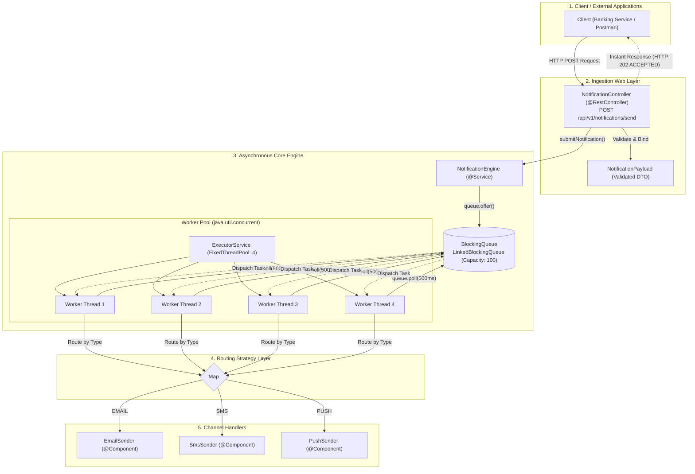

[](https://www.oracle.com/java/)
[](https://spring.io/projects/spring-boot)
[](#architecture-overview)
[](LICENSE)
# Distributed Event-Driven Notification Engine

A high-throughput, asynchronous notification microservice built with **Java** and **Spring Boot**. The service decouples notification ingestion from third-party channel delivery (Email, SMS, Push) using an in-memory thread-safe queue and a persistent worker thread pool, preventing latency propagation to upstream transactional systems.

---

## Key Features

- **Asynchronous Ingestion**: Ingests requests via REST and immediately returns `HTTP 202 ACCEPTED`, processing delivery tasks in the background.
- **In-Memory Concurrency Buffer**: Backed by `java.util.concurrent.BlockingQueue` (`LinkedBlockingQueue`) to prevent race conditions and handle burst traffic.
- **Resource Isolation**: Worker execution managed by a `FixedThreadPool` (`ExecutorService`), preventing excessive CPU thread context switching.
- **Strategy Routing Pattern**: Dynamic routing across multiple channels (`EMAIL`, `SMS`, `PUSH`) decoupled via OOP interfaces and Spring Constructor Injection.
- **Fail-Safe & Validation**: Centralized exception mapping using `@RestControllerAdvice` and request body validation via Jakarta Bean Validation.
- **Automated Integration Testing**: Verified with JUnit 5 & Spring MockMvc for contract validation and error handling.

---

## Architecture Overview



---

## API Specification

### Endpoint: Send Notification

`POST /api/v1/notifications/send`

#### Request Headers

| Header | Value |
| --- | --- |
| `Content-Type` | `application/json` |

#### Request Payload Example

```json
{
  "id": "TXN-9021",
  "recipient": "user@example.com",
  "message": "Your OTP code is 912834.",
  "type": "EMAIL"
}

```

*Supported `type` values: `EMAIL`, `SMS`, `PUSH*`

#### Response Codes

* **`202 ACCEPTED`**: Task accepted and placed into the processing queue.
* **`400 BAD REQUEST`**: Request validation failed (blank fields or invalid schema).
* **`503 SERVICE UNAVAILABLE`**: In-memory buffer is full (backpressure defense).

---

## Tech Stack

* **Language**: Java 25
* **Framework**: Spring Boot 4.x (Spring Web, Spring Validation)
* **Concurrency**: `java.util.concurrent` (`LinkedBlockingQueue`, `ExecutorService`)
* **Testing**: JUnit 5, Spring MockMvc
* **Logging**: SLF4J / Logback

---

## Setup & Running Locally

1. **Clone the repository:**
```bash
git clone [https://github.com/](https://github.com/)<raunakranjann>/NotificationEngine.git
cd NotificationEngine

```


2. **Build and run tests:**
```bash
mvn clean test

```


3. **Start the application:**
```bash
mvn spring-boot:run

```


The service will start on port `8080`.
